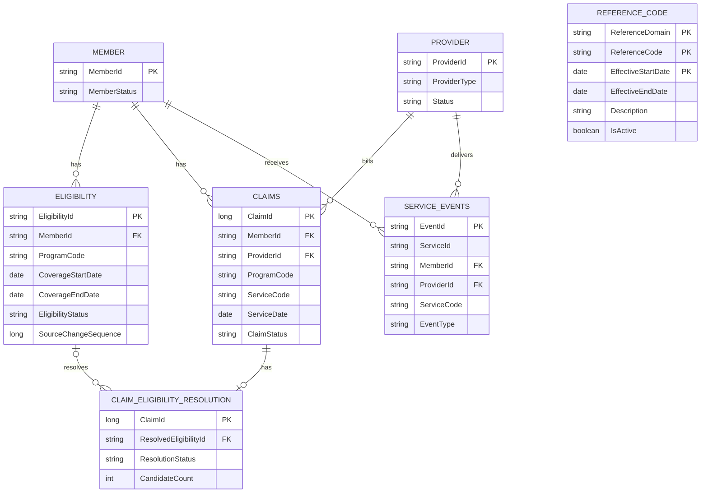


# Healthcare Entity Relationship Diagram

**Milestone:** M2.2 — Healthcare Relationships and ERD

## 1. Logical Entity Relationship Diagram

## 2. Claim-to-Eligibility Resolution

**Grain:** One row per processed ClaimId.

### Matching Criteria

Claims are matched against applicable eligibility records using:

- Claims.MemberId = Eligibility.MemberId
- Claims.ProgramCode = Eligibility.ProgramCode
- Claims.ServiceDate >= Eligibility.CoverageStartDate
- Claims.ServiceDate <= Eligibility.CoverageEndDate,
  or CoverageEndDate IS NULL.

Only applicable eligibility records and source versions
participate in matching.

### Resolution Outcomes

| Status | Meaning | Action |
|---|---|---|
| MATCHED | Exactly one matching eligibility | Store ResolvedEligibilityId |
| NO_MATCH | No matching eligibility | Preserve claim with NULL ResolvedEligibilityId |
| AMBIGUOUS_OVERLAP | Multiple distinct overlapping eligibility records | Preserve claim and candidate matches; business rule pending |

### Duplicate vs. Overlapping Eligibility

Duplicate source events and potential duplicate business
records are evaluated separately from overlapping eligibility.

- Repeated source events are deduplicated using source identity
  and version metadata.
- Potential duplicate business records are flagged for review.
- Overlapping eligibility records require an approved business rule.
- No automatic latest-CoverageStartDate selection is applied
  to ambiguous overlapping eligibility.
- Claims are preserved regardless of resolution outcome.

The resolution table maintains one row per processed ClaimId.
Multiple matching eligibility candidates must not produce
duplicate claim-resolution rows.

Candidate details may be maintained separately for
investigation and audit.

## 3. Reference Data Relationships

Reference data provides controlled business codes used
across the healthcare platform.

### Reference Validation Mapping

| Source Entity | Source Column | Reference Domain |
|---|---|---|
| ELIGIBILITY | ProgramCode | PROGRAM_CODE |
| CLAIMS | ProgramCode | PROGRAM_CODE |
| CLAIMS | ServiceCode | SERVICE_CODE |
| PROVIDER | ProviderType | PROVIDER_TYPE |
| PROVIDER | Specialties[] | SPECIALTY_CODE |
| SERVICE_EVENTS | ServiceCode | SERVICE_CODE |

### Reference Keys

**Logical code key:**

- ReferenceDomain
- ReferenceCode

**Effective-dated version key:**

- ReferenceDomain
- ReferenceCode
- EffectiveStartDate

ReferenceCode alone is not globally unique across domains.

### Reference Validation Rules

- Match each business code to its corresponding ReferenceDomain.
- Use the applicable effective-dated reference version.
- Validate code existence and applicable status.
- Flag unknown or invalid reference codes through Silver
  data-quality processing.
- Preserve reference history for effective-dated analysis.
- Effective-date intervals must not overlap for the same
  ReferenceDomain and ReferenceCode.

Reference relationships are logical validation relationships,
not direct single-column foreign keys.

The REFERENCE_CODE entity is therefore shown separately
in the logical ERD.

## 4. Modeling Rules

- Claims and Eligibility are independent source datasets.
- MemberId is the logical relationship key across Member,
  Eligibility, Claims, and Service Events.
- ProviderId is the logical relationship key between
  Provider, Claims, and Service Events.
- Eligibility historical changes are preserved.
- Claim-to-Eligibility resolution occurs in Silver.
- Claims do not contain a source EligibilityId.
- Foreign-key integrity is validated through pipelines.
- Invalid or ambiguous relationships are recorded for
  data-quality investigation.
- Gold aggregations must not multiply claim amounts.
- Reference domains validate controlled business codes.
- ServiceId groups related service events.
- EventId uniquely identifies a logical service event.
- Provider nested attributes are handled according
  to the Provider source contract.

## 5. Architecture Notes

This ERD represents the logical healthcare data model.

It does not represent every Bronze, Silver, Gold,
quarantine, or operational table.

### Source Independence

The six source datasets remain independently generated
and ingested:

1. Member — CSV
2. Eligibility — Parquet
3. Claims — SQL Server JDBC
4. Provider — REST JSON
5. Service Events — Kafka JSON/Avro
6. Reference — CSV/Parquet

### Downstream Processing

- Bronze preserves ingested source observations.
- Silver applies validation, deduplication, relationship
  resolution, and applicable history processing.
- Quarantine captures records requiring investigation.
- Gold provides trusted analytical data products.

### Deferred Business Decisions

The following rules remain pending business definition:

- Eligibility overlap resolution priority.
- Treatment of distinct records with identical coverage.
- Applicable eligibility status for historical claim matching.
- Handling of unresolved eligibility relationships in
  downstream business-specific reporting.

These rules must not be silently assumed during
pipeline implementation.
