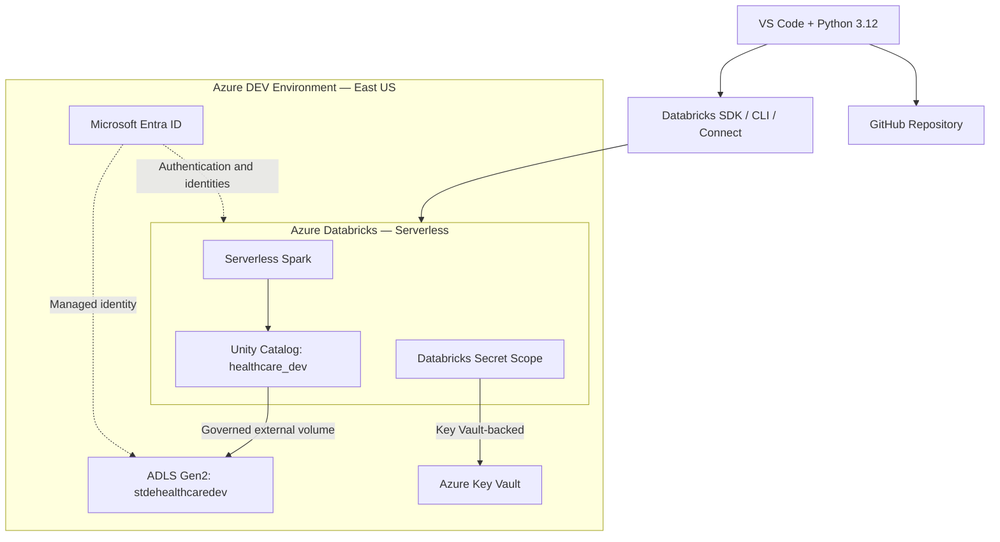
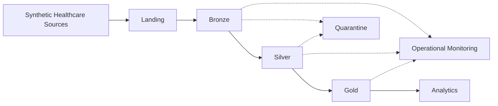

# Foundation Architecture — DEV

**Project:** Azure Databricks Healthcare Lakehouse

**Status:** Implemented foundation with planned data-processing components shown separately

## Implemented Foundation

The diagram represents the configured foundation and its logical integration boundaries. Individual network and authorization paths are simplified.

## Planned Data Processing Architecture

These pipelines are not yet implemented. They represent the target processing architecture for subsequent project milestones.

## Architecture Notes

- The current foundation uses one physical DEV environment.
- Azure Databricks Serverless is preferred to minimize infrastructure overhead.
- Unity Catalog provides governance for catalog objects and registered storage locations.
- The existing external volume `healthcare_dev.bronze.member_raw` maps to the ADLS Gen2 `raw/member` location.
- Developer authentication and automated runtime identities are separate.
- The Key Vault-backed secret scope is configured.
- CI/CD automation, Terraform provisioning, and production-style healthcare pipelines remain future work.

See [Architecture Overview](../architecture-overview.md) for detailed architecture decisions and implementation boundaries.
